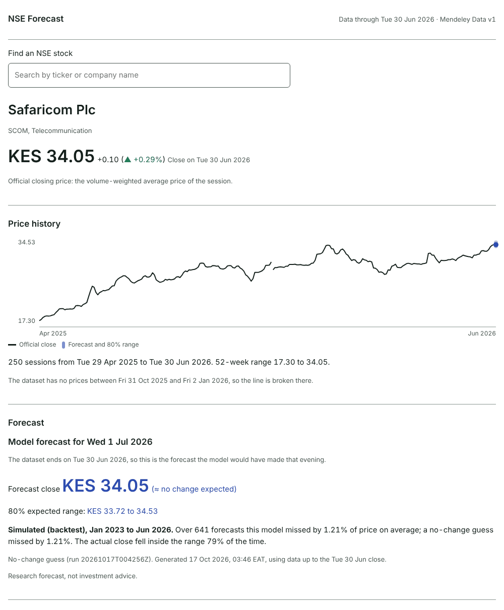
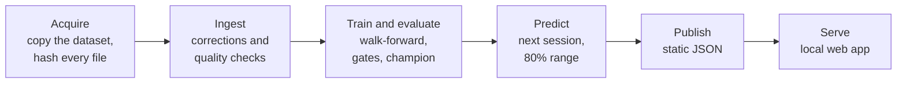

# NSE Forecast

Next-session forecasts for the most traded shares on the Nairobi Securities Exchange (NSE),
from models that must beat a no-change guess before the app shows them. One command runs
everything on your own computer and opens the results in your browser.



## The challenge

Assuming that tomorrow's close will equal today's already misses by only about 1.3% of the
price on average. That is the trap: a small miss says nothing on its own. NSE Forecast
therefore measures every model by its **skill** against that no-change guess, the share by
which it shrinks the average miss.

The NSE makes that guess hard to beat. The official close is the volume-weighted average of
the whole session, many shares trade thinly, and the data has gaps, duplicates and misdated
rows. Average-price closes and thin trading also make daily changes slightly predictable for
purely mechanical reasons, so a model must beat a per-stock AR(1) baseline as well before it
can claim to add anything. The question is whether machine learning adds real skill on top of
those effects, measured by tests fixed before any result was seen.

## Approach



1. **Traceable data.** Every source file is recorded with its SHA-256. Documented
   corrections fix misdated blocks, quality checks stop the run on errors, days without data
   are never filled in, and moves beyond the ±10% daily price band (splits, bonus issues,
   data errors) are left out of modelling.
2. **Leakage-safe features.** Features use only data up to the forecast day, and a suite of
   leakage tests runs in CI, including one that checks pure random walks show no skill.
3. **Walk-forward evaluation.** Four baselines and three machine-learning models (Ridge,
   Huber and LightGBM) are refit every quarter and tested on the sessions that follow: 2018
   to 2022 to choose, and 2023 to the end of the data only to confirm.
4. **Fixed gates.** A model becomes champion only if it beats the no-change guess by at least
   1% with a significant Diebold–Mariano test, beats the simple baselines, is stable from
   year to year, keeps its 80% range calibrated and holds up on the holdout. Otherwise a
   baseline, or the no-change guess itself, is the champion, and the app says so.
5. **Forecast and serve.** The champion forecasts the next session with a volatility-scaled
   conformal 80% range, and a React app shows the results on `127.0.0.1`.

[docs/methodology.md](docs/methodology.md) explains each step, and
[docs/architecture.md](docs/architecture.md) describes the code.

## Results

<!-- results:start -->
From `uv run nsefc run` on the NSE daily prices from Mendeley Data (2007-01-02 to 2026-06-30), default profile. The models are compared on the selection period (2018-01-01 to 2022-12-31); the holdout (2023-01-01 to 2026-06-29) only confirms the choice and was never used to make it.

**Champion: the no-change guess.** No model beat it by the margins the gates set in advance, so the framework correctly refused to ship models that did not beat a strong baseline. The closest machine-learning model was LightGBM, with a selection skill of +0.14% (DM p = 0.069) and a holdout skill of +0.59%, but it failed G-SKILL (beats the no-change guess) and G-STAB (stable from year to year). The champion's 80% range contained the actual close 80.3% of the time on the holdout, across 16 to 31 liquid NSE stocks (median 20).

| Model | Selection skill | DM p | Holdout skill | 80% range coverage | Gates |
| --- | --- | --- | --- | --- | --- |
| No-change guess | +0.00% | 1.000 | +0.00% | 79.9% | reference |
| Drift baseline | -1.26% | 1.000 | -1.13% | 80.0% | failed G-SKILL, G-BASE, G-STAB, G-HOLD |
| 5-session average baseline | -53.97% | 1.000 | -54.94% | 80.0% | failed G-SKILL, G-BASE, G-STAB, G-DIR, G-HOLD |
| AR(1) baseline | -0.37% | 0.998 | -0.03% | 80.0% | failed G-SKILL, G-STAB, G-HOLD |
| Ridge regression | -2.70% | 1.000 | -1.26% | 80.0% | failed G-SKILL, G-BASE, G-STAB, G-HOLD |
| Huber regression | -1.33% | 1.000 | -0.19% | 80.0% | failed G-SKILL, G-BASE, G-STAB, G-HOLD |
| LightGBM | +0.14% | 0.069 | +0.59% | 80.0% | failed G-SKILL, G-STAB |

Skill is 1 − (the model's average miss ÷ the no-change guess's average miss), so +1% means a miss 1% smaller than the no-change guess's (an average miss of 1.258% of the price instead of 1.271%) and a negative skill means a larger one. DM p is the one-sided Diebold–Mariano p-value for that difference. Coverage is for the selection period. [docs/methodology.md](docs/methodology.md#gates) defines the gates, and [docs/results.md](docs/results.md) has the full results.
<!-- results:end -->

## Quick start

You need [git](https://git-scm.com/downloads) and [uv](https://docs.astral.sh/uv/). Install
uv with one command:

```bash
# macOS and Linux
curl -LsSf https://astral.sh/uv/install.sh | sh
```

```powershell
# Windows (PowerShell)
powershell -ExecutionPolicy ByPass -c "irm https://astral.sh/uv/install.ps1 | iex"
```

Then clone the repository and try the app on synthetic data:

```bash
git clone https://github.com/duotkuerduot/NSE-Time-Series.git
cd NSE-Time-Series
uv run nsefc run --sample
```

`uv` installs Python 3.12 and the packages on the first run; the app opens in your browser
in about two minutes. For the real data, download the price files from Mendeley Data into
`data/source/` (they are not in this repository; [data/README.md](data/README.md) lists
them), then run:

```bash
uv run nsefc run
```

The first run takes a few minutes; a repeat run reuses everything and opens the app in
seconds. You need about 2 GB of free disk space, and an internet connection the first time,
for uv.

| Command | What it does |
| --- | --- |
| `uv run nsefc run` | All stages, then serve the app in your browser |
| `uv run nsefc run --no-serve` | All stages, then exit |
| `uv run nsefc run --source-dir PATH` | Read the dataset files from another folder |
| `uv run --extra full nsefc run --profile full` | Adds tuning, monthly refits and CatBoost; takes hours |
| `uv run nsefc status` | What is in `data/`: dataset, dates, last run, champion |
| `uv run nsefc import FILE.csv` | Add sessions after the dataset's end |
| `uv run nsefc clean` | Delete computed results (`--all` also deletes the raw copies) |

## Tech stack

* **Python 3.12**, managed by uv: pandas and pyarrow for Parquet tables, scikit-learn,
  LightGBM, SciPy, Pydantic, typer and rich; CatBoost and Optuna in the optional `full`
  extra.
* **Web app:** React 19, TypeScript, Vite, React Router and TanStack Query, built ahead of
  time and shipped inside the package, so running the tool needs no Node.js.
* **Checks:** pytest with Hypothesis, ruff, mypy (strict), import-linter, vitest, and
  Playwright with axe, on GitHub Actions for Windows, macOS and Linux.

## Project structure

```text
NSE-Time-Series/
├── src/nsefc/          the Python package: CLI, pipeline stages, models, local server
│   └── web_dist/       the prebuilt web app
├── web/                the web app's source
├── config/             settings, trading calendar, model hyperparameters, contact links
├── reference/          corrections, securities and the dataset citation
├── contracts/api/v1/   JSON Schema and fixtures for the files the app reads
├── data/               the dataset files and every output, kept out of git
├── tests/              unit, property, leakage and integration tests
└── docs/               architecture, methodology, results, decisions, contributing
```

## Limitations

* **Historical only.** The data ends on 30 June 2026, so the forecast is for a session
  already in the past. The tool demonstrates the method and its measured skill; it does not
  follow the market live. `uv run nsefc import FILE.csv` adds sessions you collect yourself.
* **Dataset quality.** There is no data from July to December 2020 or for November and
  December 2025, and the files contain duplicates and misdated rows. Documented rules handle
  them, but unknown errors may remain.
* **No corporate-action adjustment.** Moves beyond the price band are left out of modelling,
  which also removes some genuine large moves.
* **Low predictability.** Any skill over the no-change guess is small, and past results do
  not predict future ones.
* **Not investment advice.** These are research forecasts.

## Data and attribution

The price data is cited as:

> Wanjawa, Barack (2026), "Kenya Nairobi Securities Exchange (NSE) All Stocks Prices 2026",
> Mendeley Data, V1, doi: [10.17632/hvmhnp7f9r.1](https://doi.org/10.17632/hvmhnp7f9r.1)

The prices are the NSE's end-of-day data from 2 January 2007 to 30 June 2026, published on
Mendeley Data as one collection per period. The files are not in this repository: the
results above were computed from the Mendeley files placed in `data/source/`, and
[data/README.md](data/README.md) explains how to get the same files. No licence is recorded
in `reference/mendeley.yaml`, so the tool treats the data as for personal research use.

## Contact

Built by **Duot Kuer** ([GitHub](https://github.com/duotkuerduot)). Questions, ideas and
collaboration are welcome: open an issue or get in touch.

## Licence

The code is released under the [MIT licence](LICENSE). The data keeps its own licence and
citation, above. [docs/CONTRIBUTING.md](docs/CONTRIBUTING.md) explains how to contribute.
