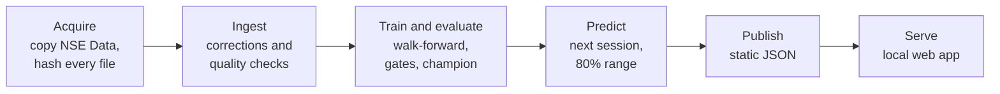

# NSE Forecast

NSE Forecast estimates the next trading session's official closing price for the most
actively traded shares on the Nairobi Securities Exchange, with an 80% expected range, and
shows honestly how good those forecasts are. One command, run on your own computer, reads
nearly 20 years of daily prices, cleans them with documented rules, trains and tests baselines and
machine-learning models through time, picks a champion by fixed gates, and opens the results
in your browser. Nothing is hosted, downloaded or uploaded, and no account or key is needed.


## Quick start

You need [git](https://git-scm.com/downloads) and [uv](https://docs.astral.sh/uv/). Install
uv with one command:

```bash
# macOS and Linux
curl -LsSf https://astral.sh/uv/install.sh | sh
```

```powershell
# Windows (PowerShell)
powershell -ExecutionPolicy ByPass -c "irm https://astral.sh/uv/install.ps1 | iex"
```

Then:

```bash
git clone https://github.com/duotkuerduot/NSE-Time-Series.git
cd NSE-Time-Series
uv run nsefc run
```

`uv` installs Python 3.12 and the packages on the first run. The whole run takes about five
minutes on a laptop; a second run reuses everything and opens the app in seconds. You need
about 2 GB of free disk space and an internet connection the first time, for `uv`. To try the
app in two minutes on synthetic data, run `uv run nsefc run --sample`.

## Results

<!-- results:start -->
From `uv run nsefc run` on Kenya Nairobi Securities Exchange (NSE) All Stocks Prices 2026 (2007-01-02 to 2026-06-30), default profile. Choices used the selection period (2018-01-01 to 2022-12-31); the holdout (2023-01-01 to 2026-06-29) was never used to choose anything.

**Champion: the no-change guess.** No model beat it by the margins the gates require, so the app shows the no-change guess and says so. On this data that is the honest result. The strongest machine-learning model, LightGBM, reduced the average miss by 0.14% in the selection period (DM p = 0.069) and 0.59% on the holdout, short of the 1% the gates ask for. The 80% range contained the actual close 80.3% of the time on the holdout, across 16 to 31 liquid NSE stocks (median 20).

| Model | Selection skill | DM p | Holdout skill | 80% range coverage | Gates (§11.4) |
| --- | --- | --- | --- | --- | --- |
| No-change guess | +0.00% | 1.000 | +0.00% | 79.9% | reference |
| Drift baseline | -1.26% | 1.000 | -1.13% | 80.0% | failed G-SKILL, G-BASE, G-STAB, G-HOLD |
| 5-session average baseline | -53.97% | 1.000 | -54.94% | 80.0% | failed G-SKILL, G-BASE, G-STAB, G-DIR, G-HOLD |
| AR(1) baseline | -0.37% | 0.998 | -0.03% | 80.0% | failed G-SKILL, G-STAB, G-HOLD |
| Ridge regression | -2.70% | 1.000 | -1.26% | 80.0% | failed G-SKILL, G-BASE, G-STAB, G-HOLD |
| Huber regression | -1.33% | 1.000 | -0.19% | 80.0% | failed G-SKILL, G-BASE, G-STAB, G-HOLD |
| LightGBM | +0.14% | 0.069 | +0.59% | 80.0% | failed G-SKILL, G-STAB |

Skill is 1 - (model's average miss / no-change guess's average miss): positive means the model missed by less. It is never an "accuracy" percentage of the price. Coverage is for the selection period; the gates are defined in [ENGINEERING.md](ENGINEERING.md) §11.4.
<!-- results:end -->

## How it works



1. **Acquire.** The dataset ships in `NSE Data/`. The tool copies it into `data/raw/` and
   records every file's SHA-256, so each number traces back to an exact file.
2. **Ingest.** Documented corrections fix misdated blocks; quality checks stop the run on
   errors; days with no data are never filled in; moves beyond the ±10% daily price band
   (splits, bonus issues, data errors) are left out of modelling.
3. **Train and evaluate.** Features use only data up to the forecast day. Four baselines and
   three machine-learning models (Ridge, Huber, LightGBM) are refitted every quarter and
   tested on the following quarter: on 2018 to 2022 to choose, and on 2023 to the end of the
   data only to confirm. A battery of leakage tests runs in CI, including one that checks pure
   random walks show no skill.
4. **Choose a champion.** A model must beat the no-change guess by at least 1% with a
   significant Diebold–Mariano test, beat the simple baselines significantly, be stable year
   to year, keep its 80% range calibrated, and hold up on the holdout. Otherwise a baseline,
   or the no-change guess itself, is the champion, and the app says so.
5. **Predict, publish and serve.** The champion forecasts the next session with a
   volatility-scaled conformal 80% range; the results are written as static JSON and served
   with the React app on `127.0.0.1`.

[docs/methodology.md](docs/methodology.md) explains each step; [ENGINEERING.md](ENGINEERING.md)
is the full design.

## Why the no-change guess is the number to beat

Guessing that tomorrow's close equals today's usually misses by only 1–2% of the price, so a
forecast can look "98% accurate" while knowing nothing. Every number here is therefore the
**skill** against that guess: how much smaller the model's average miss is. On the NSE the
official close is the session's volume-weighted average and many shares trade thinly, so daily
changes carry a mechanical carry-over from one day to the next. A per-stock AR(1) baseline
measures that effect, and a model has to beat it too before it can claim to add anything.

## Limitations

* **Historical only.** The data ends on 30 June 2026, so the forecast is for a session
  already in the past. The tool demonstrates the method and its measured skill; it does not
  follow the market live. `uv run nsefc import FILE.csv` adds sessions you collect yourself
  (include every share you want a forecast for).
* **Dataset quality.** There is no data from July to December 2020 or for November and
  December 2025, and the files contain duplicates and misdated rows. All are handled by
  documented rules, but unknown errors may remain.
* **No corporate-action adjustment.** Moves beyond the price band are left out of modelling,
  which also removes some genuine large moves.
* **Low predictability.** Any skill over the no-change guess is small, and past results do
  not predict future ones.
* **Not investment advice.** These are research forecasts.

## Data and attribution

The price data is cited as:

> Wanjawa, Barack (2026), "Kenya Nairobi Securities Exchange (NSE) All Stocks Prices 2026",
> Mendeley Data, V1, doi: [10.17632/hvmhnp7f9r.1](https://doi.org/10.17632/hvmhnp7f9r.1)

It ships in this repository's `NSE Data/` folder (2 January 2007 to 30 June 2026) and is
read at runtime; nothing is downloaded. Its licence has not yet been recorded in
`reference/mendeley.yaml`, so the tool treats the data as for personal research use. The
original prices are the Nairobi Securities Exchange's end-of-day data.
[docs/data/mendeley-dataset.md](docs/data/mendeley-dataset.md) lists every file and defect.

## Commands

| Command | What it does |
| --- | --- |
| `uv run nsefc run` | All stages, then serve the app in your browser |
| `uv run nsefc run --no-serve` | All stages, then exit |
| `uv run nsefc run --sample` | Synthetic sample data instead of `NSE Data/`: a two-minute trial |
| `uv run nsefc run --source-dir PATH` | Read dataset files in the same format from another folder |
| `uv run nsefc run --profile full` | Adds hyperparameter tuning, monthly refits and CatBoost (needs `uv run --extra full`) |
| `uv run nsefc run --force` | Recompute every stage even if cached |
| `uv run nsefc acquire` / `ingest` / `train` / `predict` / `publish` / `serve` | One stage at a time |
| `uv run nsefc import FILE.csv` | Add sessions after the dataset's end (`date, ticker, close, volume`) |
| `uv run nsefc status` | What is in `data/`: dataset, dates, last run, champion |
| `uv run nsefc clean [--all]` | Delete derived data (`--all` also deletes the raw copies) |

Exit codes: `0` success, `2` usage error, `10` dataset not found, `20` data-quality failure,
`30` training failure (including the plausibility tripwire), `40` publishing failure.

## For developers

```bash
uv run pytest                 # unit, property, leakage and integration tests
uv run ruff check . && uv run mypy && uv run lint-imports
pnpm -C web install && pnpm -C web test && pnpm -C web build   # then commit src/nsefc/web_dist
```

The built web app is committed in `src/nsefc/web_dist/`, so running the tool needs no
Node.js; CI checks that the build matches its sources. CI runs on Windows, macOS and Linux
with no secrets and no network data.

## Contact

Built by **Duot Kuer** ([GitHub](https://github.com/duotkuerduot)). Questions, ideas and
collaboration are welcome: open an issue or get in touch.

## Licence

The code is released under the [MIT licence](LICENSE). The data keeps its own licence and
citation, above.
