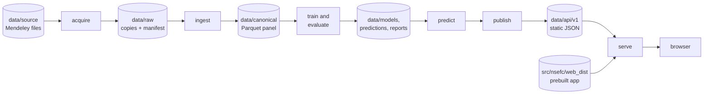

# Architecture

NSE Forecast is one Python package, `nsefc`, plus a React app that is built ahead of time and
shipped inside the package. Everything runs on your computer: the command line reads the
dataset files, computes the results into `data/`, and serves them with the app on
`127.0.0.1`. There is no hosted service, database, account or key, and nothing is downloaded
at run time; `uv` needs the internet once, to install Python and the packages.

[methodology.md](methodology.md) explains the modelling, [decisions.md](decisions.md) records
why the system is built this way, and [data/README.md](../data/README.md) describes the data
folder.

## Overview



`uv run nsefc run` runs the six stages in order; each is also a command of its own
(`nsefc acquire`, `ingest`, `train`, `predict`, `publish`, `serve`).

## Repository layout

```text
NSE-Time-Series/
├── src/nsefc/                the package (table below)
│   └── web_dist/             the built web app, committed so running needs no Node.js
├── web/                      the React app's source (Vite, TypeScript)
│   ├── src/                  pages, components, API client, generated types, styles
│   ├── e2e/                  Playwright tests with axe accessibility checks
│   └── scripts/              type generation, build hash, bundle-size check
├── config/
│   ├── default.yaml          every tunable setting, validated on load
│   ├── sample.yaml           overlay for --sample: shorter periods, smaller universe
│   ├── test.yaml             overlay for the test suite
│   ├── site.yaml             name and contact links shown in the app
│   ├── calendar/             NSE trading calendar: holidays, closures, held sessions
│   └── models/               frozen hyperparameters and search spaces per model
├── reference/                corrections, securities and the dataset citation
├── contracts/api/v1/         JSON Schema for every published file, and fixtures
├── data/                     the dataset files and every output (git-ignored)
├── tests/                    unit, property, leakage and integration tests
├── scripts/                  maintainer scripts: contract fixtures, securities draft
└── docs/                     these documents
```

### The package

| Module | Responsibility |
| --- | --- |
| `cli` | The `nsefc` command line (typer, rich): stage commands, `status`, `import`, `clean`, `dev` |
| `pipeline` | Runs the stages with caching; run context, fingerprints, run log, Markdown reports |
| `config` | Loads and validates the settings |
| `domain` | Enumerations shared across stages (severities, data modes, instrument types, unavailable reasons) |
| `calendar` | The trading calendar and all session arithmetic |
| `storage` | The data folder layout, hashing, atomic writes and folder swaps, Parquet tables |
| `acquire` | Copies the source files into `data/raw/` with SHA-256 manifests; extracts zips safely |
| `sample` | Generates the deterministic synthetic dataset used by `--sample` and CI |
| `ingest` | Reads the CSV format, applies corrections and aliases, builds the canonical panel |
| `quality` | The data-quality checks |
| `features` | The feature set and the gap guard, reading the panel only through an as-of door |
| `targets` | Next-session returns |
| `models` | Baselines, Ridge, Huber, LightGBM and CatBoost behind one interface; hash-checked model files |
| `intervals` | Volatility-scaled split conformal ranges |
| `evaluation` | The modelling table, the walk-forward harness, metrics, the Diebold–Mariano test and tuning |
| `selection` | The gates and champion selection |
| `prediction` | The forward forecast with the champion |
| `api` | The API contract: Pydantic models for every published file, JSON Schema export |
| `publishing` | Builds and validates the JSON files the app reads |
| `serve` | The local HTTP server (standard library only) |
| `devtools` | Maintainer helpers: the web build hash and the README results block |

## Stages and caching

Every stage:

1. declares its inputs (files and settings) and its outputs;
2. computes a fingerprint: a SHA-256 over its input files' hashes, the settings sections it
   uses, the package version and the source code it depends on (`STAGE_CODE` in
   `pipeline/context.py`), so an updated clone never reuses results computed by older code;
3. skips itself when its outputs exist with the same fingerprint, unless `--force` is given;
4. writes its outputs somewhere temporary and then moves them into place, so a failed stage
   leaves the earlier outputs untouched and a rerun resumes where it stopped;
5. logs JSON lines to `data/runs/<run_id>/log.jsonl`.

Each stage leaves a stamp in `data/stamps/` with its fingerprint and outputs, and
`data/runs/<run_id>/run.json` records the command, profile, dataset hashes, package version,
git commit, per-stage fingerprints, timings, outcome and champion. `acquire` caches through
its manifest instead: if the manifest lists exactly the files and hashes in the source folder
and every copy still matches, nothing is copied. A changed citation or licence only refreshes
the manifest's record.

`predict` and `publish` check the stamps' lineage and refuse outputs computed from older data,
settings or code. The publish fingerprint also includes the local date, because a forecast's
"target date is in the past" flag depends on it.

### Exit codes

| Code | Meaning |
| --- | --- |
| 0 | Success |
| 2 | Usage or configuration error, or a stage's inputs are missing |
| 10 | The dataset could not be read: no files in `data/source/` or the `--source-dir` folder |
| 20 | A data-quality check failed with severity error |
| 30 | Training or evaluation failed, including the plausibility tripwire (G-PLAUS) |
| 40 | Publishing failed, or a file did not validate against the API contract |

## Module boundaries

`pyproject.toml` encodes the layering as import-linter contracts, which CI checks:

* `domain` imports nothing else from `nsefc`; `calendar` depends only on `domain`; `config`
  and `storage` import no business module.
* The API contract depends only on `domain`.
* `acquire`, `sample`, `ingest` and `quality` never import the ML layer or publishing.
* `features` cannot import `targets`, models or results (leakage rule L2), and `targets`
  depends only on `domain` and `calendar`.
* `models` and `intervals` are pure estimators.
* `evaluation`, `selection` and `prediction` never touch acquisition or publishing.
* `publishing` and `serve` never import the ML layer.
* Only the CLI imports `pipeline`, and nothing imports the CLI.

## Configuration

* **`config/default.yaml`** holds every tunable value: paths, the citation file, quality
  thresholds, features, universe rules, periods, evaluation and interval settings, gate
  thresholds, profiles, model settings, publishing, the server and the thread count.
  `--sample` loads `config/sample.yaml` over it, and the test suite loads `config/test.yaml`.
  Settings are validated with Pydantic, and an unknown key is an error.
* **Environment.** Nothing is required. `NSEFC_DATA_DIR` moves the data folder, and
  `paths.source_dir` moves the dataset files.
* **`config/models/*.yaml`**: one file per model, with its display label, the frozen
  hyperparameters the default profile uses and the search space the full profile tunes.
* **`config/calendar/nse_holidays.yaml`**: holiday rules, dated closures and held sessions.
* **`config/site.yaml`**: the name, tagline and contact links shown in the app's footer and
  About page.
* **`reference/`**: corrections to the source files, the securities table and the dataset's
  citation ([reference/README.md](../reference/README.md)).

## Published files and the API contract

The app reads static JSON files that `publish` writes into `data/api/v1/`. Their shapes are
the API contract, version 1.1: Pydantic models in `src/nsefc/api/v1.py`. `uv run nsefc dev
contract` exports them as JSON Schema into `contracts/api/v1/`, and `pnpm -C web gen:types`
turns the schemas into the app's TypeScript types (`web/src/api/types/*.gen.ts`). The
fixtures in `contracts/api/v1/fixtures/` let the app and its tests run without a pipeline run.

| File | Contents |
| --- | --- |
| `status.json` | Run and data status, the dataset's attribution, and the current release |
| `r/<release_id>/stocks.json` | The securities index for search |
| `r/<release_id>/stocks/{TICKER}.json` | A stock's header and summary |
| `r/<release_id>/stocks/{TICKER}/history.1y.json`, `history.max.json` | Price chart data, by column |
| `r/<release_id>/stocks/{TICKER}/prediction.json` | The latest forecast, its range, and the backtest record on the holdout |
| `r/<release_id>/market/overview.json` | Session summary, movers and the homepage charts |
| `r/<release_id>/report.json` | Evaluation results for the About page: gate table, skill by year, coverage, data audit counts |
| `r/<release_id>/site.json` | Name and contact links from `config/site.yaml`, and the dataset attribution |

Every file except `status.json` sits in a release folder, so a page never mixes two
releases. A release id is `<last data session>.<first 12 hex digits of the publish
fingerprint>`, for example `2026-06-30.80bc08d4dbc8`. Each file is validated against its
model before it is written; the release is written to a temporary folder and renamed into
place; `status.json` then points to it, and the previous release stays beside it so an open
page keeps reading a complete release.

## The local server

`nsefc serve` uses Python's standard library (`ThreadingHTTPServer`):

* It binds to `127.0.0.1` only. The port comes from the settings (8000); if it is busy, the
  next 10 ports are tried and the one used is printed.
* `/api/v1/*` is served from `data/api/v1/` as JSON with `Cache-Control: no-store`.
* A path that names a file in `web_dist/` is served with an explicit MIME type (the Windows
  registry's types are unreliable); hashed assets are cached for a year.
* Any other path returns `index.html`, so the app's own routes such as `/stocks/SCOM` work.
* A path that would leave its root folder is refused, and every response carries a Content
  Security Policy limited to the app's own origin and `X-Frame-Options: DENY`.
* It opens the default browser unless `--no-browser` is given, and Ctrl+C stops it cleanly.
* Without published results it exits with "No results yet. Run `uv run nsefc run` first."

## The web app

React 19, TypeScript, Vite, React Router and TanStack Query. Charts are small SVG components
of its own (`LineChart`, `BarChart`), and styles are plain CSS with design tokens
(`web/src/styles/tokens.css` and `base.css`).

| Route | Page |
| --- | --- |
| `/` | Stock search, the market summary, movers, the NASI trend, market breadth and the model's track record |
| `/stocks/:ticker` | The price history, the forecast for the next session with its 80% range, and the backtest record |
| `/about` | How the forecasts work, the results from `report.json` (gate table, skill by year), method, limitations, data and contact |
| anything else | Not found, with a link home |

The API client reads `/api/v1/status.json` first and then the files of the release it names.
In sample mode every page shows that the data is synthetic.

**Shipping without Node.js.** `pnpm -C web build` writes the app to `src/nsefc/web_dist/`,
which is committed and packaged, so running the tool needs no Node.js. `web_dist/.source-hash`
holds a SHA-256 over `web/src/**`, `web/index.html`, `web/package.json`,
`web/pnpm-lock.yaml` and `web/vite.config.ts`; `uv run nsefc dev web-hash --check` fails when
the committed build is older than its sources. The initial JavaScript has a budget of 150 KB
gzipped (`pnpm -C web check:size`).

**Language rules.** No text in the app uses "buy", "sell", "hold", "target price", "signal",
"recommendation", "guaranteed", "will reach" or "certain", in any sense; a test matches them as
whole words, case-insensitively. Data-quality states use "paused" instead of "hold", and the
app shows gate names, never the raw gate ids. Every forecast carries "Research forecast, not
investment advice."

**Accessibility.** The app targets WCAG 2.2 AA. The Playwright tests run axe (the WCAG 2.0
and 2.1 A and AA rules) on every page at phone and desktop sizes. Targets are at least
44 × 44 px, focus is always visible, every chart has a text summary, and pages work at 200%
zoom and 360 px wide.

### Design

The design is calm and typographic: one idea per section, large type with room around it,
key figures set large with a one-line caption, a restrained palette, one primary action per
view (the stock search on the homepage), and almost no motion.

**Colour.** Cream, near-black and deep blue, and each colour has one job:

* deep blue (`--model`) is model output only (forecasts, ranges, model lines and bars), and
  the focus ring;
* green and red are only actual price changes, always next to ▲ or ▼ and a signed number;
* links and buttons are `--ink`, with an underline or weight;
* `--rule` is for decorative dividers and gridlines only, never for text or a control's
  border.

| Token | Light | Dark | Use |
| --- | --- | --- | --- |
| `--bg` | `#F6F1E7` | `#121110` | Page background |
| `--surface` | `#ECE4D4` | `#1D1B18` | Strips: notices, table headers, the selected search result |
| `--ink` | `#141414` | `#F2EBDD` | Text, the actual price line, primary buttons |
| `--ink-2` | `#4D483F` | `#B5AD9D` | Secondary text, input borders |
| `--model` | `#1B3A7A` | `#93B2FF` | Model output; focus ring |
| `--gain` | `#1E6B3A` | `#6FCB91` | Actual price rises |
| `--loss` | `#A3311D` | `#FF907B` | Actual price falls |
| `--rule` | `#9C9483` | `#6B6559` | Decorative dividers and gridlines |

Contrast, by the WCAG relative-luminance formula (text needs 4.5:1; focus rings, input
borders and chart marks need 3:1):

| Foreground | On `--bg`, light | On `--surface`, light | On `--bg`, dark | On `--surface`, dark |
| --- | --- | --- | --- | --- |
| `--ink` | 16.36 | 14.58 | 15.90 | 14.48 |
| `--ink-2` | 8.06 | 7.18 | 8.47 | 7.71 |
| `--model` | 9.65 | 8.60 | 9.03 | 8.23 |
| `--gain` | 5.79 | 5.16 | 9.54 | 8.70 |
| `--loss` | 6.19 | 5.51 | 8.56 | 7.80 |
| `--rule` (decorative only) | 2.67 | 2.38 | 3.26 | 2.97 |

Dark mode follows `prefers-color-scheme`, with its own measured values rather than an
automatic inversion.

**Type.** Inter Tight ExtraBold for page titles and the two hero numbers (the current price
and the forecast close); Inter for everything else; tabular figures everywhere, so prices line
up and do not shift. The stacks are `Inter, ui-sans-serif, system-ui, -apple-system,
BlinkMacSystemFont, "Segoe UI", sans-serif`, with `"Inter Tight"` in front for headlines.

| Role | Font | Size / line height (px) |
| --- | --- | --- |
| Hero number | Inter Tight ExtraBold (800), tracking −0.02em | 56 / 60; 44 / 48 under 600 px |
| Page title | Inter Tight ExtraBold (800), tracking −0.02em | 44 / 52; 34 / 40 under 600 px |
| Section heading | Inter SemiBold (600) | 24 / 32; 22 / 28 under 600 px |
| Subheading | Inter SemiBold | 18 / 28 |
| Body | Inter Regular (400) | 16 / 24 |
| Small text, tables | Inter Regular | 14 / 20 |
| Label (uppercase, tracking 0.08em) | Inter SemiBold | 12 / 16 |

The three font files are self-hosted woff2 (latin subset, 71 KB in total) in
`web/src/assets/fonts/`, from Fontsource 5.3.0, under the SIL Open Font License 1.1
(`OFL-Inter.txt`, `OFL-InterTight.txt`). Nothing loads from a CDN, so the app works offline.

**Layout and motion.**

* Content is at most 1120 px wide, with a 16 px gutter on phones and 32 px from 900 px up.
  Spacing follows a 4 px grid, and text columns stay under 72 characters.
* Sections are separated by space (48 px, 64 px on wide screens) and one thin rule. There are
  no cards and no shadows.
* Buttons are pill-shaped and at least 44 px tall; the search field is a 56 px pill with 16 px
  text, so phones do not zoom into it. Focus is a 2 px `--model` ring with a 2 px offset.
* Wide tables scroll sideways on small screens inside a labelled region the keyboard can
  reach; no page scrolls sideways at 360 px.
* Charts: the actual price is a 2 px `--ink` line; the forecast point and range are `--model`,
  with the range as a light wash. Markers for moves left out of modelling are `--ink-2`,
  because red means a price fall. Bars are `--model`, at most 24 px wide.
* Motion is limited to 150 ms changes of opacity, underline or border colour, or a 1 px
  shift, in response to hover, focus or press, and all of it stops under
  `prefers-reduced-motion`.

## Reproducibility and safety

* The same dataset files, settings and code give the same predictions on any machine: fixed
  seeds, deterministic LightGBM with a fixed thread count, rows sorted before training, CPU
  only. Two sample runs give byte-identical published files and the same release id.
* Every raw file is recorded with its SHA-256, so every canonical row traces to an exact file,
  and every correction is listed in the data audit.
* Model files are pickle-based (joblib), so the loader accepts only files this tool wrote,
  with a matching SHA-256 sidecar; it never downloads or accepts model files from elsewhere.
* Nothing is downloaded at run time, the server listens on `127.0.0.1` only, and CI uses the
  synthetic sample with no secrets.
