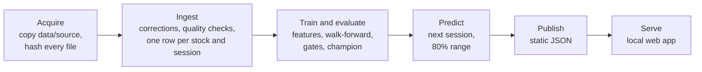

# Methodology

How NSE Forecast turns the historical price files into a next-session forecast, and how it
decides whether a forecast deserves to be shown. The app's About page is the short version of
this document. [results.md](results.md) has the numbers from the latest run, and
[architecture.md](architecture.md) describes the code.

## The question

For each actively traded share on the Nairobi Securities Exchange (NSE), what will the next
session's official closing price be, and how far from it is the actual close likely to fall?
And is a model's answer better than simply assuming the price will not change?

The NSE's official close is the volume-weighted average price (VWAP) of the whole session,
not the last trade. That matters twice. The target is an average, and averages of consecutive
sessions share information, so daily changes are slightly predictable for purely mechanical
reasons. Many shares also trade thinly, and a share that does not trade keeps its previous
price, which adds more carry-over from one day to the next.

## Data

The data is the NSE's daily price files from Mendeley Data, 2 January 2007 to 30 June 2026:
20 yearly price files with one row per security per session (price, previous price, day high
and low, volume) plus index levels, and seven sector files. It is cited as:

> Wanjawa, Barack (2026), "Kenya Nairobi Securities Exchange (NSE) All Stocks Prices 2026",
> Mendeley Data, V1, doi: 10.17632/hvmhnp7f9r.1

[data/README.md](../data/README.md) explains how to get the files and lists every file,
column and known defect.

## Six stages



Each stage records a fingerprint of its inputs (file hashes, settings and the code it depends
on) and is skipped when nothing has changed, so a second run takes seconds.

## Cleaning the data

* **Corrections** are explicit rules in `reference/corrections.yaml`. Each rule is tied to
  the SHA-256 of the file it fixes and to a line range inside it, so it can never apply to a
  different file. A rule that matches no rows, or would create a duplicate, stops the run. The
  rules fix three misdated blocks in the 2009 file and a block in the 2017 file dated 2015.
* **Duplicates.** Identical duplicate rows are dropped and counted. A conflicting duplicate
  stops the run.
* **Missing sessions** are scheduled trading days with no data for any security. They are
  never filled in. The second half of 2020 and November to December 2025 are missing
  entirely, and 26 other weekdays have no data.
* **Untraded days.** A listed security with no row in a held session gets a carried-forward
  row with volume 0 and the last close, because an unchanged price is what the exchange
  reports. Rows are only carried forward after the market-level checks, and never inside a
  missing session.
* **Large moves.** A move beyond the ±10% daily price band plus 0.5 percentage points is an
  event: a split, a bonus or rights issue, a new listing, a data error, or a move across a
  gap in the data. Events are shown in the app but left out of modelling, because there is no
  corporate-actions source to adjust for them.
* **High and low** are set to null on days without trades, because the source repeats stale
  quotes.

### Quality checks

Each check has a severity: **error** stops the run (exit code 20), **exclude** drops the rows
from modelling but keeps them for display, and **warn** is reported only. Every check's count
and examples are in `data/reports/data-audit.md`.

| Check | Rule | Severity |
| --- | --- | --- |
| SCH-01 | Required columns are present and parse | error |
| SCH-02 | Price above zero, volume not negative, high not below low | exclude |
| KEY-01 | No duplicate (ticker, session) after corrections | error |
| DAT-01 | Every date is a weekday | error |
| DAT-02 | Data falls only on scheduled or held sessions | warn |
| DAT-03 | Each file's rows fall in the year its file name states | error |
| PRC-01 | The move from the previous close stays within ±10.5% | exclude |
| VOL-01 | Turnover ÷ volume is close to the close (VWAP basis); the dataset has no turnover, so this applies to imports only | warn |
| MKT-01 | A session quotes at least 70% of the trailing 20-session median number of securities; if not, market features are null for it | warn |
| GAP-01 | Missing sessions are listed with their ranges | warn |
| IMP-01 | Imported sessions come after the dataset's last session | error |

### Trading calendar

`config/calendar/nse_holidays.yaml` lists the statutory holidays, the moon-dependent dates
and the one-off closures, each with a status (`rule`, `confirmed`, `listed` or
`provisional`) and a source. A holiday on a Sunday moves to the next weekday that is not a
holiday. Where the data shows a full session on a day the rules would close, the calendar
records a held session, because for history the data wins. All date logic ("the next
session") goes through the calendar; nothing adds a day to a date. The calendar covers 2005
to 2026. If the data ends where the calendar has no coverage, the forecast date falls back to
the next weekday and the app says so.

## Target

```text
y(i, T) = C(i, T+1) / C(i, T) − 1          T+1 = the next held session after T
forecast close(i, T+1) = C(i, T) × (1 + ŷ)
```

If the security does not trade at T+1, `y = 0` and the row is kept, because an unchanged
price is exactly what the exchange reports. A row has no label when its next move is an event
or when the next held session is not the next scheduled one (a missing session lies between).
Training labels are capped at ±10.5%; evaluation never is. Models are trained with an L1 or
Huber loss, so the forecast is a conditional median and the average absolute miss is the
right yardstick.

## Features

Features are scale-free (returns and ratios, never raw price levels), use only data up to the
forecast day, and count windows in trading sessions. One code path builds them for training
and for the forecast.

| Family | Features |
| --- | --- |
| Returns | Log returns over 1, 2, 3, 5, 10 and 20 sessions |
| Trend | Close against its 5, 20 and 50-session averages; distance from the 250-session high and low |
| Volatility | Standard deviation of daily returns over 5 and 20 sessions; exponentially weighted volatility (λ = 0.94, over the 60-session window); day range `(high − low) / close` |
| Liquidity | `log1p(volume)`; `ln((1 + volume) / (1 + 20-session median volume))`; share of the last 20 sessions traded; sessions since the last trade, capped at 60 |
| Market | Equal-weighted return of all ordinary shares over 1 and 5 sessions; breadth `(advancers − decliners) / n`; NASI return over 1 and 5 sessions (null before NASI starts in February 2008) |
| Calendar | Day of week; days to the next session |
| Static | Sector, from the sector files |

The settings are under `features:` in `config/default.yaml`. Rolling statistics are computed
window by window rather than as running sums, so every value depends only on its own window.

### Leakage rules

| Rule | Requirement |
| --- | --- |
| L1 | Feature code receives the panel cut off at the forecast day, and checks that cut-off |
| L2 | No negative shifts, centred windows, back-fill or interpolation in `features/` (an AST test enforces it), and `features` cannot import `targets` (import-linter enforces it) |
| L3 | Every shift and rolling window is grouped by ticker, on data sorted by ticker and date |
| L4 | Anything fitted (imputers, scalers, winsorisation bounds) is fitted on each refit's training rows only, inside the scikit-learn pipeline saved with the model |
| L5 | No random splits: each training window ends before its test window starts |
| L6 | Membership of the forecast universe at a date uses only data up to that date; delisted securities stay in the training history |
| L7 | Results far better than plausible are treated as a leakage bug (the G-PLAUS gate) |

**Gap guard.** A row is valid only if its 60-session lookback window contains no missing
session and no event for that security. Rows that fail are left out of training and
evaluation and counted in the report. The 250-session high and low features become null
instead of invalidating the row. One rule handles the 2020 gap, the end-2025 gap and stock
splits.

**Leakage tests.** Features computed on data cut off at day T equal those computed on the
full data (a Hypothesis property test); changing every later row changes nothing; no value
crosses from one stock to the next; labels line up exactly on a series with a known next
value; pure random walks show no significant skill; and on synthetic AR(1) data the harness
finds roughly the planted skill.

## Models

Every model forecasts the next-session return and runs in the same harness, so a baseline can
win.

| Model | Forecast |
| --- | --- |
| No-change guess (B0) | 0: tomorrow's close equals today's |
| Drift baseline (B1) | The stock's mean daily return over the last 250 sessions |
| 5-session average baseline (B2) | `SMA_5 / close − 1`: a pull back towards the recent average |
| AR(1) baseline (B3) | Per stock, the last return times a coefficient fitted by least absolute deviations over the last 500 sessions (at least 50 return pairs) |
| Ridge regression | One linear model pooled across stocks: median imputation, in-fold winsorisation and scaling, then Ridge |
| Huber regression | The same pipeline with a Huber loss |
| LightGBM | Gradient-boosted trees with an L1 loss, shallow trees and large leaves, early-stopped on the last 10% of sessions in each training window |
| CatBoost | Gradient-boosted trees with an MAE loss; only in `--profile full` |

The machine-learning models are pooled across all stocks in the forecast universe; there is
no model per ticker. B3 matters most: because the close is a session average and many shares
trade thinly, daily returns have a mechanical positive autocorrelation, so the no-change
guess can be beaten without any real insight. Beating B0 is necessary; beating B3 shows a
model adds something.

**Hyperparameters.** The default profile uses fixed values in `config/models/*.yaml`, chosen
before any result was seen. `uv run --extra full nsefc dev tune` tunes them with Optuna on the
tuning period only. Runs are deterministic: fixed seeds, LightGBM in deterministic mode with a
fixed thread count, rows sorted before training, CPU only.

**Model files** are saved with joblib under `data/models/<run_id>/`, each with a JSON
sidecar holding its SHA-256. The loader refuses a file whose hash does not match, and the tool
only loads model files it produced itself.

## Evaluation

| Period | Dates | Used for |
| --- | --- | --- |
| Warm-up | 2007 to 2012 | Training history only |
| Tuning | 2013 to 2017 | Hyperparameter tuning, in `--profile full` only; never for selection |
| Selection | January 2018 to December 2022 | Every decision: the gates G-SKILL to G-CAL |
| Holdout | January 2023 to the end of the data | Confirmation (G-HOLD) and the headline numbers; never used to choose anything |
| Forecast | The session after the data ends | The champion, refit on all data |

* **Walk-forward.** Models are refit every quarter (every month in `--profile full`) on
  everything before the refit date, then forecast every session until the next refit. The
  walk-forward starts 250 sessions before the selection period, and those early predictions
  only calibrate the ranges, so coverage is honest from the first selection day.
* **Primary metric.** MAE skill against the no-change guess, `1 − MAE(model) / MAE(B0)`,
  pooled over every stock and session. Errors are in return space, so an absolute error is
  also the miss as a share of the last close. A one-sided Diebold–Mariano test on the daily
  cross-sectional mean loss difference (Newey–West variance, 5 lags) says whether the skill
  is significant.
* **Also reported.** Directional calls on sessions where the price moved and the forecast was
  not flat (outside ±0.1%), against "always up", "always down" and the sign of the last move;
  the 80% range's coverage and width; skill by year, by liquidity tercile and by volatility
  regime.
* **Not used:** percentage errors on returns (undefined when the actual return is zero, which
  is common), R² on price levels (inflated by persistence), and errors in shillings (dominated
  by high-priced shares).

Changes to features, models, hyperparameters or gates are never made because of holdout
results.

## Ranges

The 80% expected range is volatility-scaled split conformal:

1. `σ` is the stock's exponentially weighted volatility up to T (λ = 0.94), floored at 0.25%.
2. Scores `s = (y − ŷ) / σ` come from the most recent 250 sessions of out-of-sample
   walk-forward predictions, pooled across stocks. In-sample residuals are never used, and a
   score is only used once its actual was known.
3. The range is `[ŷ + q10(s) · σ, ŷ + q90(s) · σ]` in return space, turned into prices with
   `C(T) × (1 + bound)` and clipped to the ±10% band.

The app calls it an "80% expected range", never a confidence interval, and shows its holdout
coverage next to it.

## Gates

A model becomes champion only if it passes every gate. The thresholds are in
`config/default.yaml` under `gates:` and were fixed before any result was seen.

| Gate | Name in the app | Condition |
| --- | --- | --- |
| G-INT | Integrity checks | The model file's hash matches; no missing predictions; lower ≤ point ≤ upper; reloading the file reproduces its predictions within 1e-9 |
| G-SKILL | Beats the no-change guess | Selection skill at least 1%, with a one-sided Diebold–Mariano p below 0.05 |
| G-BASE | Beats the simple baselines | Selection MAE no worse than the best of B1 to B3, and significantly better than it (paired one-sided test, p below 0.10); otherwise the simpler model wins |
| G-STAB | Stable from year to year | Positive skill in at least 4 of the 5 selection years, and no year below −2% |
| G-DIR | Direction no worse than simple rules | Directional calls not significantly worse than the best trivial sign rule (one-sided z-test at 0.05) |
| G-CAL | 80% range is calibrated | Selection coverage between 75% and 85% |
| G-HOLD | Confirmed on the holdout period | Holdout skill positive and at least half the selection skill |
| G-PLAUS | Plausibility tripwire | Pooled skill above 15%, or directional calls right more than 65% of the time, stops the run with exit code 30 whatever the other gates say, because results that good on this problem almost always mean a leak |

## Choosing the champion

1. Machine-learning models that pass every gate are ranked by their selection MAE. If the
   best is not significantly better (p below 0.10) than a simpler one, the simpler one wins.
   Simpler means: baseline, then Ridge or Huber, then LightGBM, then CatBoost.
2. If no machine-learning model passes, the best of B1 to B3 that passes G-INT, G-SKILL,
   G-BASE and G-CAL is the champion.
3. Otherwise the champion is the no-change guess, and the app says so.

The champion is always named for what it is ("AR(1) baseline", never "AI model"), and the gate
table for every model is in `data/reports/evaluation.md` and on the About page.

## The forecast universe

Forecasts are made only for liquid ordinary shares. At each refit date and at the forecast
date, a share is in the universe if it traded on at least 80% of the last 250 held sessions,
its median daily value traded (volume × close, since the dataset has no turnover) is at least
KES 150,000, and it has at least 500 sessions of history. Rights lines, preference shares,
ETFs and REITs never enter it. Every security stays visible in the app; a security without a
forecast says why (for example a recent large move inside its 60-session window).

## Adding recent sessions

The dataset ends on 30 June 2026, so the forecast is for a session that is already in the
past. `uv run nsefc import FILE.csv` adds sessions you collected yourself, after the dataset's
last session, from a CSV with the columns `date, ticker, close, volume` and optionally
`high, low, open, turnover, prev_close`. Imported rows pass the same quality checks, the app
labels them as imported, and the next `uv run nsefc run` uses them. Include every share you
want a forecast for: a share with no row in the imported sessions gets no forecast.

## Limitations

1. **Historical only.** The forecast is for the session after the dataset ends, which is in
   the past. The tool shows the method and its measured skill; it does not follow the market.
2. **Dataset quality.** The data has a six-month gap in 2020, a two-month gap at the end of
   2025, duplicates and misdated rows. Documented rules handle them, but unknown errors may
   remain.
3. **No corporate-action adjustment.** Moves beyond the price band are left out of modelling,
   which also removes some genuine large moves.
4. **Low predictability.** Any skill over the no-change guess is small, and part of it comes
   from the mechanics of average-price closes and thin trading, which the AR(1) baseline
   measures.
5. **Not investment advice.** These are research forecasts.
