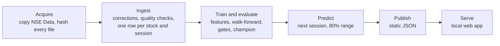

# Methodology

How NSE Forecast turns the historical price files into a next-session forecast, and how it
decides whether a forecast deserves to be shown. This is the long form of the app's About
page; [ENGINEERING.md](../ENGINEERING.md) is the full design.

## The question

For each actively traded share on the Nairobi Securities Exchange (NSE), what will the next
session's official closing price be, and how far from it is the actual close likely to fall?

The NSE's official close is the volume-weighted average price (VWAP) of the whole session,
not the last trade. That matters twice: the forecast target is an average, and averages of
consecutive sessions overlap in information, which makes daily changes slightly predictable
for purely mechanical reasons.

## Data

The data is the copy of the NSE daily price files in the repository's `NSE Data/` folder,
cited as:

> Wanjawa, Barack (2026), "Kenya Nairobi Securities Exchange (NSE) All Stocks Prices 2026",
> Mendeley Data, V1, doi: 10.17632/hvmhnp7f9r.1

It covers 2 January 2007 to 30 June 2026: 20 yearly price files with one row per security per
session (price, previous price, day high and low, volume) plus index levels, and seven sector
files. `docs/data/mendeley-dataset.md` lists every file, column and defect.

## Six stages

Each stage records a fingerprint of its inputs (file hashes, settings and the code it
depends on) and is skipped when nothing has changed, so a second run takes seconds.

## Cleaning the data

* **Corrections** are explicit rules in `reference/corrections.yaml`, each tied to the
  SHA-256 of the file it fixes: three misdated blocks in the 2009 file and a block in the
  2017 file dated 2015. Identical duplicate rows are dropped; conflicting ones would stop the
  run.
* **Quality checks** (§6.6) block the run on errors (duplicate keys, weekend dates, rows
  outside their file's year), drop impossible rows (no price, high below low) and report
  warnings.
* **Missing sessions** are scheduled trading days with no data for any security. They are
  never filled in: the second half of 2020 and November to December 2025 are missing
  entirely, and 26 other weekdays have no data.
* **Untraded days** for a listed security get a carried-forward row with volume 0, because
  an unchanged price is exactly what the exchange reports.
* **Large moves** beyond the ±10% daily price band (plus 0.5 percentage points) are treated
  as events (splits, bonus and rights issues, listings, data errors) and left out of
  modelling, since there is no corporate-actions source to adjust for them.

## Target and features

The target is the next session's simple return, `C(T+1) / C(T) − 1`, where T+1 is the next
trading session in the calendar. A price forecast is `C(T) × (1 + forecast)`. Training
labels are capped at ±10.5%; evaluation never is.

Features use only data up to the forecast day and count windows in trading sessions:

| Family | Features |
| --- | --- |
| Returns | log returns over 1, 2, 3, 5, 10 and 20 sessions |
| Trend | price against its 5, 20 and 50-session averages; distance from the 250-session high and low |
| Volatility | standard deviation of daily returns over 5 and 20 sessions; exponentially weighted volatility; day range |
| Liquidity | volume, volume against its 20-session median, share of recent sessions traded, sessions since the last trade |
| Market | equal-weighted market return over 1 and 5 sessions, breadth, NASI return |
| Calendar and static | day of week, days to the next session, sector |

A **gap guard** drops any row whose 60-session window contains a missing session or a large
move for that stock, so no feature or label ever spans the 2020 gap or a stock split.

Leakage tests check that features computed on data cut off at day T equal those computed on
the full data, that changing every later row changes nothing, that no value crosses from one
stock to another, that labels line up exactly, and that pure random walks show no skill.

## Models

All models forecast the next-session return and run in the same harness, so a baseline can
win.

| Model | What it does |
| --- | --- |
| No-change guess (B0) | Tomorrow's close equals today's |
| Drift (B1) | The stock's average daily return over the last 250 sessions |
| 5-session average (B2) | A pull back towards the recent average |
| AR(1) baseline (B3) | Per stock, today's return times a coefficient fitted by least absolute deviations over the last 500 sessions |
| Ridge and Huber regression | One linear model pooled across stocks, with in-fold winsorisation, imputation and scaling |
| LightGBM | Gradient-boosted trees with an L1 loss, shallow trees, large leaves and early stopping |
| CatBoost | Only in the slower `--profile full` |

## Evaluation

* **Walk-forward.** Models are refitted every quarter on everything before the refit date,
  then forecast the following quarter. The test window always starts after the training
  window ends.
* **Periods.** Selection: 2018 to 2022, used for every decision. Holdout: 2023 to the end of
  the data, never used to choose anything; it only confirms and supplies the headline
  numbers. A year of walk-forward predictions before 2018 calibrates the ranges.
* **Primary metric.** MAE skill against the no-change guess: `1 − MAE(model) / MAE(no
  change)`, pooled over every stock and session. A one-sided Diebold–Mariano test on the
  daily average loss difference (Newey–West variance, 5 lags) says whether the skill is
  significant.
* **Also reported.** Directional accuracy on sessions where the price moved and the forecast
  was not flat, against always-up, always-down and the sign of the last move; the 80% range
  coverage; skill by year, by liquidity and by volatility.

## Ranges

The 80% expected range is volatility-scaled split conformal: the past errors of the same
model, divided by each stock's recent volatility, give the 10th and 90th percentiles of a
scaled error; today's range is the forecast plus those percentiles times today's volatility.
Only errors whose actuals were already known calibrate a range, and the ranges are clipped to
the ±10% band.

## Gates and the champion

A model becomes champion only if it passes every gate, fixed before any result was seen:

| Gate | Condition |
| --- | --- |
| Integrity | the saved model reloads to the same predictions; no gaps; ranges in order |
| Beats the no-change guess | selection skill at least 1%, Diebold–Mariano p below 0.05 |
| Beats the simple baselines | no worse than the best of drift, average and AR(1), and significantly better (p below 0.10), or the simpler model wins |
| Stable from year to year | positive skill in at least 4 of 5 selection years, no year below −2% |
| Direction no worse than simple rules | directional accuracy not significantly below the best trivial rule |
| 80% range is calibrated | selection coverage between 75% and 85% |
| Confirmed on the holdout period | holdout skill positive and at least half the selection skill |

If no machine-learning model passes, the best baseline that beats the no-change guess is the
champion; if none does, the no-change guess is, and the app says so. A plausibility tripwire
stops the run if any model's skill exceeds 15% or its directional accuracy 65%, because on
this problem results that good almost always mean a leak.

## Limitations

1. **Historical only.** The forecast is for the session after the dataset ends, which is in
   the past. The tool shows the method and its measured skill; it does not follow the market.
2. **Dataset quality.** The data has a six-month gap in 2020, a two-month gap at the end of
   2025, duplicates and misdated rows.
   They are handled by documented rules, but unknown errors may remain.
3. **No corporate-action adjustment.** Moves beyond the price band are left out of modelling,
   which also removes some genuine large moves.
4. **Low predictability.** Any skill over the no-change guess is small, and part of it comes
   from the mechanics of average-price closes and thin trading, which the AR(1) baseline
   measures.
5. **Not investment advice.** Research forecasts only.
